  

</body>
</html>

---

## 🟢 ABOUT MASPEL

> Exploring technology, creating useful things, and turning ideas into reality.

- 🤖 AI tools and experiments
- ⚙️ Automation and practical workflows
- 💻 Open-source technology
- 🎨 Digital creativity and learning

## ⚡ TECHNOLOGY

## 🧬 DIGITAL ACTIVITY

## ◈ CURRENT MISSIONS

- `01` — Explore AI and local agents
- `02` — Build useful automations
- `03` — Learn by making real projects
- `04` — Improve a little every day

  

SMALL STEPS · REAL PROGRESS · KEEP BUILDING

# 

### 

 

<!-- SKILLS BADGES -->
<table align="center">
<tr>
<td>

</td>
</tr>
<tr>
<td>

</td>
</tr>
</table>

 

<!-- ANIMATED NEURAL NETWORK SVG -->
<svg width="700" height="400" viewBox="0 0 700 400" xmlns="http://www.w3.org/2000/svg">
  <defs>
    <radialGradient id="nodeGlow" cx="50%" cy="50%" r="50%">
      <stop offset="0%" style="stop-color:#ffffff;stop-opacity:0.9"/>
      <stop offset="50%" style="stop-color:#00FF88;stop-opacity:0.6"/>
      <stop offset="100%" style="stop-color:#00FF88;stop-opacity:0"/>
    </radialGradient>
    <filter id="glow">
      <feGaussianBlur stdDeviation="3" result="coloredBlur"/>
      <feMerge>
        <feMergeNode in="coloredBlur"/>
        <feMergeNode in="SourceGraphic"/>
      </feMerge>
    </filter>
    <linearGradient id="lineGrad" x1="0%" y1="0%" x2="100%" y2="0%">
      <stop offset="0%" style="stop-color:#00FF88;stop-opacity:0.1"/>
      <stop offset="50%" style="stop-color:#00FF88;stop-opacity:0.6"/>
      <stop offset="100%" style="stop-color:#00FF88;stop-opacity:0.1"/>
    </linearGradient>
  </defs>

  <!-- Background -->
  <rect width="700" height="400" fill="#0a0e17" rx="12"/>

  <!-- Grid lines -->
  <g stroke="#00FF88" stroke-opacity="0.05" stroke-width="0.5">
    <line x1="0" y1="50" x2="700" y2="50"/>
    <line x1="0" y1="100" x2="700" y2="100"/>
    <line x1="0" y1="150" x2="700" y2="150"/>
    <line x1="0" y1="200" x2="700" y2="200"/>
    <line x1="0" y1="250" x2="700" y2="250"/>
    <line x1="0" y1="300" x2="700" y2="300"/>
    <line x1="0" y1="350" x2="700" y2="350"/>
    <line x1="100" y1="0" x2="100" y2="400"/>
    <line x1="200" y1="0" x2="200" y2="400"/>
    <line x1="300" y1="0" x2="300" y2="400"/>
    <line x1="400" y1="0" x2="400" y2="400"/>
    <line x1="500" y1="0" x2="500" y2="400"/>
    <line x1="600" y1="0" x2="600" y2="400"/>
  </g>

  <!-- Title -->
  <text x="350" y="35" text-anchor="middle" font-family="monospace" font-size="14" fill="#00FF88" letter-spacing="4" opacity="0.8"></text>

  <!-- CONNECTIONS with animated dashes -->
  <g stroke="#00FF88" stroke-width="1" fill="none" opacity="0.3">
    <!-- Layer 1 to Layer 2 -->
    <line x1="120" y1="120" x2="260" y2="80" stroke-dasharray="4,4">
      <animate attributeName="stroke-dashoffset" from="0" to="-16" dur="2s" repeatCount="indefinite"/>
    </line>
    <line x1="120" y1="120" x2="260" y2="160" stroke-dasharray="4,4">
      <animate attributeName="stroke-dashoffset" from="0" to="-16" dur="2.5s" repeatCount="indefinite"/>
    </line>
    <line x1="120" y1="120" x2="260" y2="240" stroke-dasharray="4,4">
      <animate attributeName="stroke-dashoffset" from="0" to="-16" dur="1.8s" repeatCount="indefinite"/>
    </line>
    <line x1="120" y1="200" x2="260" y2="80" stroke-dasharray="4,4">
      <animate attributeName="stroke-dashoffset" from="0" to="-16" dur="2.2s" repeatCount="indefinite"/>
    </line>
    <line x1="120" y1="200" x2="260" y2="160" stroke-dasharray="4,4">
      <animate attributeName="stroke-dashoffset" from="0" to="-16" dur="1.9s" repeatCount="indefinite"/>
    </line>
    <line x1="120" y1="200" x2="260" y2="240" stroke-dasharray="4,4">
      <animate attributeName="stroke-dashoffset" from="0" to="-16" dur="2.3s" repeatCount="indefinite"/>
    </line>
    <line x1="120" y1="200" x2="260" y2="320" stroke-dasharray="4,4">
      <animate attributeName="stroke-dashoffset" from="0" to="-16" dur="2.1s" repeatCount="indefinite"/>
    </line>
    <line x1="120" y1="280" x2="260" y2="160" stroke-dasharray="4,4">
      <animate attributeName="stroke-dashoffset" from="0" to="-16" dur="2.4s" repeatCount="indefinite"/>
    </line>
    <line x1="120" y1="280" x2="260" y2="240" stroke-dasharray="4,4">
      <animate attributeName="stroke-dashoffset" from="0" to="-16" dur="1.7s" repeatCount="indefinite"/>
    </line>
    <line x1="120" y1="280" x2="260" y2="320" stroke-dasharray="4,4">
      <animate attributeName="stroke-dashoffset" from="0" to="-16" dur="2.6s" repeatCount="indefinite"/>
    </line>

   
  </g>

  <!-- TRAVELING PARTICLES (animated circles along paths) -->
  <circle r="3" fill="#ffffff" filter="url(#glow)">
    <animateMotion dur="3s" repeatCount="indefinite" path="M120,120 L260,160 L400,220 L540,200 L620,250"/>
  </circle>
  <circle r="2.5" fill="#00FF88" filter="url(#glow)">
    <animateMotion dur="4s" repeatCount="indefinite" path="M120,200 L260,80 L400,140 L540,100 L620,150"/>
  </circle>
  <circle r="2" fill="#ffffff" filter="url(#glow)">
    <animateMotion dur="3.5s" repeatCount="indefinite" path="M120,280 L260,240 L400,300 L540,300 L620,250"/>
  </circle>
  <circle r="3" fill="#00FF88" filter="url(#glow)">
    <animateMotion dur="4.5s" repeatCount="indefinite" path="M120,120 L260,240 L400,60 L540,100 L620,150"/>
  </circle>
  <circle r="2" fill="#ffffff" filter="url(#glow)">
    <animateMotion dur="3.2s" repeatCount="indefinite" path="M120,200 L260,320 L400,360 L540,300 L620,250"/>
  </circle>

  <!-- NODES - Layer 1 (Input) -->
  <g>
    <circle cx="120" cy="120" r="12" fill="url(#nodeGlow)" filter="url(#glow)">
      <animate attributeName="r" values="10;14;10" dur="2s" repeatCount="indefinite"/>
    </circle>
    <circle cx="120" cy="120" r="6" fill="#00FF88" opacity="0.8">
      <animate attributeName="opacity" values="0.5;1;0.5" dur="2s" repeatCount="indefinite"/>
    </circle>

   
  </g>

  <!-- NODES - Layer 2 -->
  <g>
    <circle cx="260" cy="80" r="10" fill="url(#nodeGlow)" filter="url(#glow)">
      <animate attributeName="r" values="8;12;8" dur="2.1s" repeatCount="indefinite"/>
    </circle>
    <circle cx="260" cy="80" r="5" fill="#00FF88" opacity="0.8">
      <animate attributeName="opacity" values="0.5;1;0.5" dur="2.1s" repeatCount="indefinite"/>
    </circle>

  
  </g>

  <!-- NODES - Layer 3 (Hidden) -->
  <g>
    <circle cx="400" cy="60" r="9" fill="url(#nodeGlow)" filter="url(#glow)">
      <animate attributeName="r" values="7;11;7" dur="2s" repeatCount="indefinite"/>
    </circle>
    <circle cx="400" cy="60" r="4.5" fill="#00FF88" opacity="0.8">
      <animate attributeName="opacity" values="0.5;1;0.5" dur="2s" repeatCount="indefinite"/>
    </circle>

    
  </g>

  <!-- NODES - Layer 4 -->
  <g>
    <circle cx="540" cy="100" r="10" fill="url(#nodeGlow)" filter="url(#glow)">
      <animate attributeName="r" values="8;12;8" dur="2.2s" repeatCount="indefinite"/>
    </circle>
    <circle cx="540" cy="100" r="5" fill="#00FF88" opacity="0.8">
      <animate attributeName="opacity" values="0.5;1;0.5" dur="2.2s" repeatCount="indefinite"/>
    </circle>

    
  </g>

  <!-- NODES - Layer 5 (Output) -->
  <g>
    <circle cx="620" cy="150" r="12" fill="url(#nodeGlow)" filter="url(#glow)">
      <animate attributeName="r" values="10;14;10" dur="2s" repeatCount="indefinite"/>
    </circle>
    <circle cx="620" cy="150" r="6" fill="#00FF88" opacity="0.8">
      <animate attributeName="opacity" values="0.5;1;0.5" dur="2s" repeatCount="indefinite"/>
    </circle>

   
  </g>

  <!-- Axis Labels -->
  <text x="120" y="390" text-anchor="middle" font-family="monospace" font-size="10" fill="#00FF88" opacity="0.6"></text>
  <text x="350" y="390" text-anchor="middle" font-family="monospace" font-size="10" fill="#00FF88" opacity="0.6"></text>
  <text x="620" y="390" text-anchor="middle" font-family="monospace" font-size="10" fill="#00FF88" opacity="0.6"></text>
</svg>

 

</td>
</tr>
</table>

 

<!-- PROGRESS BAR -->
<table align="center">
<tr>
<td>

**🟢 MODEL TRAINING**

</td>
<td>

</td>
<td>

**LOSS DOWN / ACCURACY UP **

</td>
</tr>
</table>

 

<!-- GITHUB STATS -->
<table align="center">
<tr>
<td>
  
</td>
<td>
  
</td>
</tr>
</table>

 

 

<!-- FOOTER -->
---

  

<!-- Efek Mengetik (Typing Effect) Warna Hijau -->

  

<!-- Kotak Terminal Palsu -->

  

 

  

                  

